# 🔐 Federação Zero-Trust: GitHub Actions OIDC + OpenBao HA

Este documento descreve a arquitetura e o fluxo de autenticação **Zero-Trust** utilizando **OpenID Connect (OIDC)** entre o **GitHub Actions** e o cluster **OpenBao**.

O que a federação elimina é a credencial de **leitura de segredos**: não existe mais token de OpenBao nem `secret_id` de AppRole em disco no caminho do CI — o job troca um JWT de vida curta por um token de 15 minutos.

O que **continua estático**, e é importante não confundir: a **chave SSH do runner para o bastion** (`secrets.KEY`, usada pelo `appleboy/ssh-action`). Ela autentica o *transporte* até o nimbus, não o acesso ao OpenBao. Uma chave SSH comprometida dá shell no bastion, mas **não** lê segredos do cofre.

---

## 1. Contexto e Motivação (Zero-Trust Architecture)

### O Problema dos Tokens Estáticos
Tradicionalmente, pipelines de CI/CD utilizam segredos estáticos (como tokens de serviço do Vault gravados nos *GitHub Secrets* ou arquivos `.token` no nó bastion). Essa abordagem apresenta vulnerabilidades:
* Risco de vazamento em logs ou comprometimento de nós intermediários.
* Dificuldade de rotação periódica e revogação granular.
* Falta de rastreabilidade fina (auditoria não identifica qual execução exata realizou a operação).

### A Solução via OIDC
Com a Federação OIDC:
1. O GitHub Actions emite um **token JWT criptograficamente assinado** para o job em execução.
2. O OpenBao valida a assinatura do JWT contra as chaves públicas oficiais do GitHub (`jwks`).
3. O OpenBao inspeciona as claims do JWT (`repository`, `actor`, `ref`) e emite um **token de curtíssima duração (TTL: 15 minutos)** vinculado à política de menor privilégio (`iam-reader`).
4. Ao final da execução, o token expira automaticamente sem deixar rastros ou credenciais reutilizáveis.

---

## 2. Diagrama de Sequência Completo (Topologia de Rede Real)

> [!IMPORTANT]
> **Isolamento de Rede:** O cluster OpenBao (`vault.maas`) **não possui IP público nem portas abertas para a internet**. Ele reside na rede privada interna (`.maas`).
> O GitHub Actions **não faz requisições HTTP diretas** ao OpenBao pela internet. O Runner obtém o JWT na nuvem do GitHub e o encaminha por **SSH para o bastion nimbus** (`nimbus.dc.ufscar.br:2002`, usuário `iam`). É o nimbus que roda o `ansible-playbook`; o JWT viaja no ambiente do processo e o `lookup('env', 'ACTIONS_ID_TOKEN')` o lê no controller. O `POST /v1/auth/jwt/login` é executado pela tarefa `uri` **no host alvo `idp.maas` (`200.18.99.87`)**, dentro da rede `.maas`.

```mermaid
sequenceDiagram
    autonumber
    actor Dev as 👤 Desenvolvedor
    box rgb(30, 40, 55) "Nuvem Pública (GitHub Cloud)"
        participant GHA as ☁️ GitHub Actions Runner
        participant GHOIDC as 🐙 GitHub OIDC (token.actions)
    end
    box rgb(20, 50, 40) "Borda & Datacenter Local (Rede Privada .maas)"
        participant NIMBUS as 🖥️ Bastion nimbus (SSH :2002)
        participant IDP as ⚙️ idp.maas (200.18.99.87)
        participant PROXY as 🛡️ Tinyproxy (idp.maas:8888)
        participant BAO as 🗝️ OpenBao HA (vault.maas:8200)
        participant KV as 📦 OpenBao KV-v2 (secret/iam/*)
    end

    Dev->>GHA: git push origin main
    Note over GHA: Job inicia com permission: "id-token: write"
    
    rect rgb(35, 45, 60)
        Note over GHA,GHOIDC: FASE 1: Emissão do JWT na Nuvem
        GHA->>GHOIDC: GET $ACTIONS_ID_TOKEN_REQUEST_URL&audience=https://vault.maas:8200
        GHOIDC-->>GHA: Retorna OIDC JWT Token (assinado com chave RSA do GitHub)
        Note over GHA: ::add-mask:: no JWT e envio em $GITHUB_OUTPUT
    end

    rect rgb(25, 55, 45)
        Note over GHA,NIMBUS: FASE 2: SSH para o bastion com o JWT no ambiente
        GHA->>NIMBUS: appleboy/ssh-action (secrets.KEY) com env: ACTIONS_ID_TOKEN
        NIMBUS->>IDP: ansible-playbook (host alvo: 200.18.99.87)
        Note over NIMBUS: lookup('env','ACTIONS_ID_TOKEN') resolve aqui (controller)
        
        Note over IDP,BAO: FASE 3: Troca do JWT por Token do OpenBao
        IDP->>BAO: POST http://vault.maas:8200/v1/auth/jwt/login {"role": "github-actions", "jwt": "..."}
        
        Note over BAO,PROXY: OpenBao consulta chaves públicas via Egress Proxy
        BAO->>PROXY: CONNECT token.actions.githubusercontent.com:443
        PROXY->>GHOIDC: GET /.well-known/jwks
        GHOIDC-->>PROXY: Retorna JWKS (chaves públicas RSA)
        PROXY-->>BAO: Encaminha chaves públicas
        
        Note over BAO: Valida assinatura, aud, claims (repository="cloudlabs-ufscar/*") e TTL
        BAO-->>IDP: Retorna OpenBao Client Token (TTL: 15m, policy: "iam-reader")
    end

    rect rgb(30, 50, 60)
        Note over IDP,KV: FASE 4: Leitura de Segredos e Deploy
        IDP->>BAO: GET /v1/secret/data/iam/database (Header: X-Vault-Token)
        BAO->>KV: Recupera segredos encriptados no Raft Storage
        KV-->>BAO: Retorna credenciais do PostgreSQL
        BAO-->>IDP: HTTP 200 {"data": {"data": {"keycloak_db_password": "..."}}}
        
        IDP->>BAO: GET /v1/secret/data/iam/keycloak (Header: X-Vault-Token)
        BAO-->>IDP: HTTP 200 {"data": {"data": {"admin_password": "..."}}}
        
        Note over IDP: Ansible renderiza templates e atualiza containers
        IDP-->>NIMBUS: resultado das tarefas
        NIMBUS-->>GHA: Deploy concluído com sucesso via SSH
        Note over GHA: Token expira automaticamente em 15 minutos (Zero-Trust)
    end
```



---

## 3. Detalhamento Técnico Passo a Passo

### Passo 1: Permissão e Solicitação do JWT no GitHub Actions
No workflow `.github/workflows/deploy.yml`, o job declara a permissão explícita para solicitar tokens de identidade:
```yaml
permissions:
  contents: read
  id-token: write    # <-- Permite gerar o token OIDC
```
O runner utiliza as variáveis internas injetadas pelo GitHub para obter o token. Este é o passo real do `deploy.yml`:

```yaml
- name: Request a GitHub OIDC token for OpenBao
  id: openbao-oidc
  run: |
    set -euo pipefail
    AUDIENCE="https://vault.maas:8200"
    RESPONSE=$(curl -sS -H "Authorization: bearer ${ACTIONS_ID_TOKEN_REQUEST_TOKEN}" \
      "${ACTIONS_ID_TOKEN_REQUEST_URL}&audience=${AUDIENCE}")
    JWT=$(printf '%s' "$RESPONSE" | jq -r '.value // empty')
    if [ -z "$JWT" ]; then
      echo "::error::Nao foi possivel obter o JWT do GitHub: $RESPONSE"
      exit 1
    fi
    echo "::add-mask::$JWT"
    echo "jwt=$JWT" >> "$GITHUB_OUTPUT"
```

A `audience` **precisa** ser exatamente `https://vault.maas:8200`: é o valor que o role compara em `bound_audiences`. Um JWT emitido para outra audiência (mesmo repositório, mesmo emissor) é rejeitado.

O JWT segue para o bastion no `env` do `appleboy/ssh-action`:

```yaml
- name: Connect and Deploy via SSH
  uses: appleboy/ssh-action@v1.2.5
  env:
    ACTIONS_ID_TOKEN: ${{ steps.openbao-oidc.outputs.jwt }}
  with:
    ...
    envs: ACTIONS_ID_TOKEN,KEYCLOAK_GITHUB_CLIENT_ID,KEYCLOAK_GITHUB_CLIENT_SECRET
```

#### Anatomia das Claims do JWT do GitHub:
```json
{
  "iss": "https://token.actions.githubusercontent.com",
  "aud": "https://vault.maas:8200",
  "repository": "cloudlabs-ufscar/Auth-repo",
  "actor": "n-qber",
  "ref": "refs/heads/main",
  "sha": "5f201a8...",
  "job_workflow_ref": "cloudlabs-ufscar/Auth-repo/.github/workflows/deploy.yml@refs/heads/main"
}
```

---

### Passo 2: Troca do JWT por Token de Acesso no OpenBao
A tarefa `uri` da role `deploy` (`roles/deploy/tasks/fetch-secrets.yml`) faz um `POST` no endpoint de autenticação JWT do OpenBao. A requisição sai do **host alvo** (`idp.maas`), não do runner:

```http
POST /v1/auth/jwt/login HTTP/1.1
Host: vault.maas:8200
Content-Type: application/json

{
  "role": "github-actions",
  "jwt": "eyJhbGciOiJSUzI1NiIs..."
}
```

O playbook aceita **duas portas de entrada explícitas** e nenhuma silenciosa:

| Origem | Como chega | Quando usar |
| :--- | :--- | :--- |
| GitHub Actions | `ACTIONS_ID_TOKEN` no ambiente do controller (nimbus) | Deploy normal via push/`workflow_dispatch` |
| Operador | `-e openbao_token=<token>` | Execução manual de emergência |

Se **nenhuma** das duas existir, o playbook falha antes de tentar ler qualquer segredo, com mensagem explícita. Não há fallback para AppRole nem para arquivo de token.

---

### Passo 3: Validação das Chaves via Egress Proxy (Tinyproxy)
Como o cluster OpenBao reside na rede interna `.maas` sem gateway de internet direto, o serviço utiliza a configuração de proxy configurada em `/etc/systemd/system/openbao.service.d/proxy.conf`:
* `HTTPS_PROXY=http://idp.maas:8888`
* O `tinyproxy` filtra o tráfego estritamente para `token.actions.githubusercontent.com`.
* O OpenBao baixa o JWKS (`https://token.actions.githubusercontent.com/.well-known/jwks`) e valida:
  1. **Assinatura criptográfica:** Garante que o token foi emitido pelo GitHub.
  2. **Emissor (`bound_issuer`):** `https://token.actions.githubusercontent.com`, configurado no *método* (`auth/jwt/config`) — o campo é ignorado se colocado no role.
  3. **Audiência (`bound_audiences`):** precisa ser `https://vault.maas:8200`, senão qualquer JWT do mesmo repositório emitido para outro serviço seria aceito.
  4. **Validade temporal (`exp`):** Garante que o token não expirou.
  5. **Regra de vinculação (`bound_claims`):** Valida se `repository` pertence a `cloudlabs-ufscar/*` (comparação `glob`).

---

### Passo 4: Emissão do Token de Sessão Scoped
O OpenBao devolve um token temporário com a política restrita `iam-reader`:
```json
{
  "auth": {
    "client_token": "s.a1b2c3d4e5f6g7h8",
    "accessor": "accessor-xyz",
    "policies": ["default", "iam-reader"],
    "token_policies": ["default", "iam-reader"],
    "lease_duration": 900,
    "renewable": false
  }
}
```

---

### Passo 5: Leitura dos Segredos via REST API
Com o token em mãos (`s.a1b2c3d4e5f6g7h8`), a automação (ou playbook Ansible) executa chamadas simples e seguras:
```bash
# Leitura das senhas do banco de dados:
curl -s -H "X-Vault-Token: $CLIENT_TOKEN" \
  http://vault3.maas:8200/v1/secret/data/iam/database | jq .data.data

# Leitura da senha do admin do Keycloak:
curl -s -H "X-Vault-Token: $CLIENT_TOKEN" \
  http://vault3.maas:8200/v1/secret/data/iam/keycloak | jq .data.data
```

---

## 4. Configuração Aplicada no OpenBao (`scripts/ansible-iam/tasks/configure-openbao-proxy-oidc.yml`)

A configuração do motor OIDC no OpenBao é realizada de forma idempotente via Ansible (roda no líder, `vault[0]`):

```yaml
# 1. Método JWT/OIDC — bound_issuer vive na CONFIG do método
- name: Configure JWT OIDC discovery URL
  ansible.builtin.uri:
    url: "http://127.0.0.1:8200/v1/auth/jwt/config"
    method: POST
    body_format: json
    body:
      oidc_discovery_url: "https://token.actions.githubusercontent.com"
      bound_issuer: "https://token.actions.githubusercontent.com"

# 2. Role do GitHub Actions com menor privilégio
- name: Configure GitHub Actions OIDC role
  ansible.builtin.uri:
    url: "http://127.0.0.1:8200/v1/auth/jwt/role/github-actions"
    method: POST
    body_format: json
    body:
      role_type: "jwt"
      user_claim: "actor"
      bound_audiences:
        - "https://vault.maas:8200"
      bound_claims_type: "glob"
      bound_claims:
        repository: "cloudlabs-ufscar/*"
      policies:
        - "iam-reader"
      ttl: "15m"
```

Estado verificado em **2026-11-05** no líder:

| Item | Valor |
| :--- | :--- |
| `oidc_discovery_url` | `https://token.actions.githubusercontent.com` |
| `bound_audiences` | `[https://vault.maas:8200]` |
| `bound_claims` | `map[repository:cloudlabs-ufscar/*]` (glob) |
| `token_policies` | `[iam-reader]` |
| `token_ttl` | `15m` |

`iam-reader` concede apenas `read` em `secret/data/iam/*`.

---

## 5. Matriz de Segurança e Privilégios

| Componente | Nível de Acesso | Política | Validade |
| :--- | :--- | :--- | :--- |
| **GitHub Actions JWT** | Emissor de identidade | OIDC Claims (`aud`, `repository`, `actor`) | Curta, definida pelo GitHub |
| **OpenBao Client Token** | Leitura exclusiva de `secret/data/iam/*` | `iam-reader` | 15 minutos |
| **Egress Proxy (Tinyproxy)** | Somente saída HTTP/HTTPS para JWKS | Whitelist de domínio | Permanente |
| **Chave SSH do runner → nimbus** | Shell no bastion (não lê o cofre) | `secrets.KEY` no GitHub | **Estática** — rotacionar manualmente |
| **Tokens de OpenBao em disco (CI)** | — | **Eliminados do caminho do CI** | N/A |

### O que ainda é estático (e por quê)

- **Chave SSH do runner** (`secrets.KEY`): o GitHub precisa de *alguma* credencial para entrar no
  nimbus. Ela não dá acesso ao OpenBao — o token do cofre só nasce do JWT. Substituir por
  outro mecanismo (ex.: runner self-hosted) é uma decisão separada.
- **`/opt/iam/.openbao-deploy-approle` no `idp.maas`**: AppRole `idp-deploy`, mantido como
  **caminho manual de emergência** para quando não há GitHub (ex.: deploy local com
  `-e openbao_token=`). O playbook **não** o usa mais. Depois do primeiro deploy OIDC
  bem-sucedido, pode ser revogado.

---

## 6. Estado de Implementação (2026-11-05)

| Verificação | Resultado |
| :--- | :--- |
| `deploy.yml` declara `permissions: id-token: write` e pede o JWT com a audiência correta | Sim |
| `fetch-secrets.yml` troca o JWT em `auth/jwt/login` (role `github-actions`) | Sim |
| Sem JWT e sem `-e openbao_token`, o playbook falha antes de ler segredos | Sim — `ok=9, failed=1`, mensagem explícita |
| Com `-e openbao_token` (token de AppRole), o deploy completo roda | Sim — `ok=31, changed=2, failed=0` |
| JWT inválido é rejeitado pelo OpenBao | Sim — `error verifying token signature` (não é erro de rede: o JWKS é alcançável via proxy) |
| Cadeia JWT completa (env → login → policy → leitura → deploy) | Sim, com JWT assinado por chave de teste em mount descartável — `ok=33, changed=2, failed=0` (ver §7) |
| O nó do OpenBao alcança o GitHub **direto**, sem proxy | Não — `curl` direto dá `000`; o egress depende do Tinyproxy |

**Limitação conhecida:** o que só o GitHub pode fornecer é o JWT real (assinatura + claims).
O resto da cadeia está provado por comando (§7). O primeiro `push` em `main` é a validação
final — e se falhar, o deploy para (por design), com recuperação manual documentada.

---

## 7. Como testar a cadeia sem o GitHub

O único pedaço que depende do GitHub é a emissão do JWT. Todo o resto pode ser exercitado com
um **mount de auth descartável** e uma chave própria — sem tocar no mount `jwt` real:

1. No líder do OpenBao, gerar par de chaves e criar `jwt-test`:
   ```bash
   bao auth enable -path=jwt-test jwt
   bao write auth/jwt-test/config \
     jwt_validation_pubkeys=@/tmp/oidc-test/pub.pem \
     bound_issuer="https://token.actions.githubusercontent.com"
   # role com os MESMOS parâmetros da github-actions (bound_audiences, bound_claims, ttl)
   ```
2. Montar um JWT com as claims do GitHub (`iss`, `aud=https://vault.maas:8200`,
   `repository=cloudlabs-ufscar/Auth-repo`, `actor`, `exp`) e assinar com RS256
   (`openssl dgst -sha256 -sign`).
3. Rodar o playbook exatamente como o CI faz, trocando só o mount:
   ```bash
   ACTIONS_ID_TOKEN="$(cat /tmp/oidc-test/jwt)" \
     ansible-playbook -i inventory/inventory tasks/first-deploy.yml \
     -e openbao_jwt_mount=jwt-test -e ansible_user=ubuntu
   ```
   `openbao_jwt_mount` existe só para isso; o default é `jwt`.
4. **Sempre** derrubar o mount depois: `bao auth disable jwt-test` e apagar a chave privada.

O audit log registra a troca: `path=auth/jwt-test/login`, `type=response`,
`policies=["default","iam-reader"]`. É a prova de que cada login fica rastreável.
